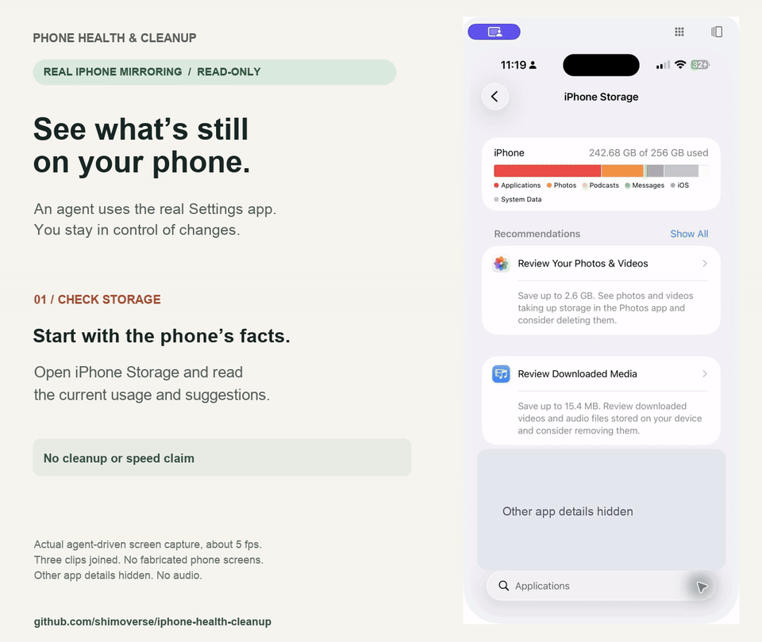
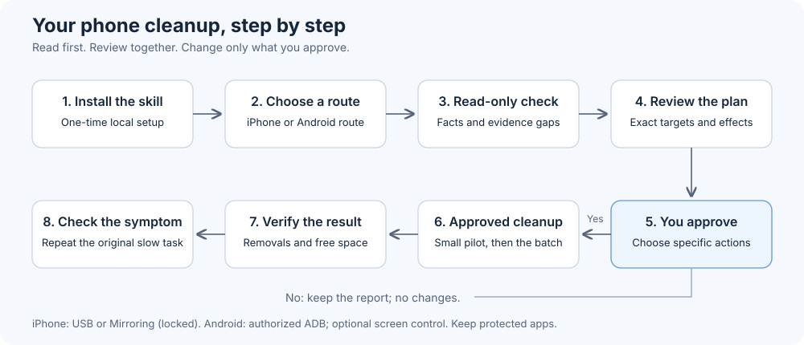

# Phone Health & Cleanup — iPhone + Android

Two open-source skills for a local AI assistant: understand a slow or full phone, review unused apps, and clean up only what you approve. One repository, separate iPhone and Android modules; the existing repository URL stays the same.

**Public preview:** both modules have offline safety tests using fake devices. Real-device compatibility, time savings and storage recovery have not been benchmarked. Start with a read-only check. No Apple or Google endorsement or affiliation.

## You see the report before anything is deleted

| Stage | What you should receive |
|---|---|
| Inventory | The apps the assistant could inspect, their installed/offloaded status and available storage facts. A partial scan must be labeled partial. |
| Recommendation | A **Recommend deleting / Keep / Need your input** list, with reasons and local-data consequences. |
| Your changes | You can keep any recommended app. Unclear identities remain held for a question. |
| One approval | Approval covers one exact deletion list. The assistant should not ask again per app within that unchanged batch. New targets need new approval. |
| Checked results | A small pilot, verified removals, retained-app checks, and separate pending/failed results. Storage and speed changes need their own measurements. |

Keep trading, finance and cryptocurrency apps, including exchanges, wallets and trackers; password managers; and all authenticators, including Duo. Identity checks and user exclusions matter because name filters cannot recognize every sensitive app. **Installed iPhone apps stay kept by default:** the included iPhone deletion script handles ordinary offloaded apps only.

| Choose your phone | Skill | Main connection |
|---|---|---|
| iPhone | [`iphone-health-cleanup`](skills/iphone-health-cleanup/SKILL.md) | Trusted USB for scripts; iPhone Mirroring for supported screen steps |
| Android / Google Pixel | [`android-health-cleanup`](skills/android-health-cleanup/SKILL.md) | Owner-authorized ADB over USB; paired wireless optional; scrcpy optional for screen steps |

## The story behind the skill

[I asked my AI agent to help with a slow iPhone](docs/blog/article.md) follows the original problem, the iPhone Mirroring attempt and the skill built to make the work more explicit and checkable. It includes the user journey, comparison charts, a demo and safety FAQs. See [the companion files](docs/blog/README.md) for the interactive version.

## Watch the agent use a real iPhone

[](docs/demo/iphone-mirroring-live-demo.mp4)

**24-second read-only demo:** the agent searches the real iPhone Storage list, opens Netflix's offloaded-app details and returns to the unchanged list. iOS displays **328.4 MB of retained documents and data**. This is an observed app-data figure, not measured recovered space.

[Watch/download MP4](docs/demo/iphone-mirroring-live-demo.mp4) · [Capture details and limits](docs/demo/README.md)

Captured from the actual Mirroring window at about five frames per second, with three clips joined and captions added. Unrelated app details are hidden. No delete or reinstall request was sent. This demonstrates one on-screen inspection, not a complete inventory, an approval conversation, scripted USB cleanup or a speedup benchmark.

## The problem it solves

On iPhone, a cloud icon marks an offloaded app: its software is removed while documents and data remain. On Android, installed apps, temporary caches and large files offer different cleanup opportunities; archived apps need a separate native review. Reviewing these one by one means repeated navigation, confirmations and checks.

This project gives your assistant a repeatable process:

1. Read a small set of phone facts and build the appropriate app inventory.
2. Explain what is known, what is unknown and what might help.
3. Show the exact apps or actions proposed for cleanup.
4. Wait for your approval, then perform supported actions and check the result.

It preserves authenticators, cryptocurrency exchanges and wallets, password managers and other protected account apps. Unclear app identities stay for review.

**Recovered storage and a faster phone are different results.** Battery wear, heat, network conditions and power settings can also explain slowness. The assistant should check the original symptom again after cleanup. [Apple's performance guidance](https://support.apple.com/en-us/102598), [Google's Pixel performance guidance](https://support.google.com/pixelphone/answer/6377329?hl=en).

## What works today?

| Capability | iPhone | Android / Pixel |
|---|---|---|
| Model/OS/build, free space and available battery facts | Included USB scripts | Included ADB script |
| App inventory and exact approval list | Offloaded apps | Installed third-party apps for the selected owner user |
| Approved app removal | Ordinary offloaded apps; verify repeated absence | Ordinary installed apps; explicit owner user and version guard; verify repeated absence |
| Cache-only app cleanup | Native screen steps where supported | Included guarded requests on Android 13/API 33+ **only if the device advertises the exact capability**; cache-byte recovery remains unverified |
| Battery wear, usage and security review | Settings plus current sources | Pixel Settings plus current sources; model-dependent capacity/cycles |
| Browser history/cache | Guided Safari/Chrome/Brave controls | Guided browser controls; no app-data wipe |
| Duplicate/blurred photos and large videos | Planned on-phone workflow | Reuse Files by Google / Google Photos review screens; **no bundled media scanner or deletion engine** |
| Archived/retained-data app cleanup | Offloaded workflow above | Native guided review; no guess from broad package-list flags |
| Guaranteed speedup, universal health score or malware-free certificate | Not provided | Not provided |

Protected apps include authenticators, cryptocurrency exchanges/wallets, password managers, finance/recovery apps and essential device services. Unknown app identities stay for review. Android additionally checks system packages, default roles, keyboards, accessibility services, device administrators and always-on VPN where accessible. Incomplete protection checks block scripted mutations.

**Android preview batch limit:** uninstall-only plans can continue in two-app steps after a verified pilot. Cache/mixed plans stop at two requests and need native cache review before a fresh small plan. Pending requests block retries; changing the plan does not bypass that safeguard. See the [Android workflow](skills/android-health-cleanup/references/workflow.md).

Mac Photos-library access is not required. Neither module roots/jailbreaks a phone, unlocks its bootloader or installs a phone profile/app. Installing the skill grants no phone access. Optional screen tools require their own setup and permission.

## Connection options and phone availability

**iPhone: USB scripts or iPhone Mirroring screen steps. Android: authorized ADB scripts, with optional scrcpy screen control.** Mirroring does not replace iPhone USB scripting. Android does not require Apple-style locked-phone Mirroring.

| Route | What it can do in this project | Can I use my phone at the same time? |
|---|---|---|
| **iPhone USB — scripted checks and app cleanup** | Run the included health snapshot, offloaded-app inventory and approved deletion/verification scripts. Needs a data-capable cable and existing trust. | **Generally yes during read-only checks.** USB does not reserve the phone screen. For an actual deletion batch, keep the phone idle and avoid app installs/removals or related data changes until verification finishes. |
| **iPhone Mirroring — on-screen review and cleanup** | Inspect Settings and perform supported approved screen actions, such as browser cleanup, if your assistant can actually read and control the mirrored screen. No USB cable is required for Mirroring itself. | **Direct phone use interrupts Mirroring.** Keep the iPhone nearby and locked; unlocking/using it stops the mirrored session. You can interact with the phone through the Mac instead. |
| **Android ADB — USB or paired wireless** | Included snapshot, installed-app plan and approved actions. Owner enables debugging and accepts the computer’s authorization prompt. Wireless debugging requires supported Android and explicit pairing. | **Generally yes for read-only checks.** Keep the phone idle during app changes and keep the connection available until verification finishes. |
| **Android scrcpy — optional screen control** | Mirrors/controls the shared phone screen through an authorized connection. Useful for native Settings or Files review; not required for the scripts. | Physical use and automation share the foreground. Stop screen automation when the owner takes over. Secure screens and lock authentication remain protected. |
| **iPhone: both, in separate stages** | For example, use USB for the app batch, then Mirroring for browser settings. | A cable may remain connected while mirroring, but the phone still needs to stay locked for the mirrored stage. Only one controller changes the phone at a time. |

### Does my phone become unavailable?

- **A USB connection does not put the phone into an exclusive-use or maintenance mode.** Ordinary use is generally possible while read-only facts are collected. The included scripts do not lock the phone or deliberately restart it. Service access can still require you to unlock it or resolve a connection prompt; real-device behavior is not yet validated for this release.
- **Only the actual cleanup stage needs a short, undisturbed window.** Installing/deleting apps, clearing the same data or starting another cleanup can make the approved state stale. Keep the cable connected until the request and verification finish. You can use the phone while the assistant prepares an offline plan or while you review the report; changed targets are rechecked before execution.
- **With Mirroring, you can take your phone back by unlocking it.** The assistant's on-screen work must stop. Lock the phone and reconnect when ready, then verify the current screen and any earlier action before continuing. An action already submitted may have completed; pausing is not an undo. [Apple's Mirroring safety guidance](https://support.apple.com/en-ca/guide/personal-safety/ips70daa1bcf/web).
- **If you need to disconnect or interrupt a USB batch, ask the assistant to stop first.** An in-flight removal may still finish. Reconnect and reconcile the saved journal/current app state; never blindly retry a possibly completed removal.

### Mirroring prerequisites and limits

Apple requires a compatible Apple-silicon/T2 Mac on macOS 15+, an iPhone on iOS 18+, the same Apple Account with two-factor authentication, Wi-Fi/Bluetooth, and a nearby locked phone. Availability is region-dependent. Some authentication, camera/microphone and call functions are unavailable inside Mirroring. You handle credentials and any physical-phone authentication yourself; that can interrupt the mirrored stage. Check [Apple's current Mirroring requirements](https://support.apple.com/en-us/120421).

Opening Mirroring is not proof that an agent can automate it. The assistant must confirm that it can read the real app screen, tap and scroll accurately. If it sees only window controls, loses the session, or cannot verify an action, it stops and offers guided steps. Mirroring-only work cannot claim the bundled scripts' structured inventory or repeated API verification. AirPlay screen sharing is not an equivalent interactive control route.

## The user journey



When the host supports subagents, storage, battery/performance and security analysts can review the same saved facts in parallel. One controller owns phone access and performs changes in sequence. Without subagents, the same checks run sequentially.

## How much time could it save?

**No measured end-to-end speedup is available yet.** The clearest benefit is avoiding repeated app-by-app navigation and reducing assistant screenshot loops.

For illustration only, if finding, confirming and checking each app takes a person **15 seconds**, the repetitive portion would take:

| Apps to handle | Illustrative manual work | What this workflow changes |
|---|---|---|
| 20 | 5 minutes | One reviewed list replaces repeated navigation |
| 50 | 12.5 minutes | A script submits and verifies the approved requests |
| 100 | 25 minutes | Detailed results stay in local files instead of repeated screenshots |

Those figures are arithmetic examples, not observed human timings or promised savings. Connection setup, user review, phone processing and verification still take time; scripted deletion requests run in sequence. Mirroring uses on-screen steps and has no demonstrated speedup here. A small list may not repay first-time setup. Record actual duration and before/after free space in your first run before making savings claims. More subagents are not automatically cheaper.

## Before you start

- A local assistant that can read the skill and run local commands. Helpers use Unix file locking: macOS/Linux are the intended hosts; native Windows execution is not supported in this preview. Linux device setup is not validated here. Screen automation needs a working control tool, or your help.
- For the installer and USB setup: Python **3.11 or newer recommended**, plus Git. The existing offline suite was initially developed on macOS Python 3.9; a current Python avoids its old TLS-library warning. A host can also read the skill directly for Mirroring-only guided work.
- For **iPhone USB scripts**: an iPhone, a data-capable cable and an existing trusted connection. If needed, unlock the phone and complete Apple's Trust prompt yourself. The scripts will not pair automatically.
- For **Mirroring screen steps**: a compatible Mac/iPhone pair, Apple's Mirroring setup and an assistant with working computer-control access, or your help. No USB cable or Python device library is needed just for these screen steps. Keep the iPhone locked during Mirroring.
- For **Android scripts**: separately installed [official Android Platform Tools](https://developer.android.com/tools/releases/platform-tools), a data-capable USB cable, and the phone owner’s Developer options > USB debugging authorization. The preview supports the personal owner user **0** only; work/private/secondary profiles are excluded. Never enable OEM unlocking/root. Android helpers use Python’s standard library; no Python device package is required. Afterward, turn debugging off/revoke computer authorization if no longer needed.
- A few minutes to review the proposed list. Uninstalling an app can remove its local saved data. Cache-only is a distinct action and can make the next launch slower while files rebuild.

A browser-only chatbot cannot run these local scripts by itself. Installing this skill neither installs a phone app nor grants phone access.

## Install: ask your agent

Copy this into a local coding assistant:

```text
Install the appropriate Phone Health & Cleanup module for my phone from:
https://github.com/shimoverse/iphone-health-cleanup

Review README.md, NOTICE.md and the selected module’s SKILL.md first.
Clone it into a local tools folder. Select --platform iphone or android.
Run tools/install_skill.py --dry-run
for the appropriate host (codex, claude or agents), show the destination,
then install the skill without overwriting any existing skill.
Only iPhone USB scripts need the pinned Python device library in an
isolated environment. Android uses separately installed official ADB.
Mirroring-only guided steps do not need the Python device library.
Report setup readiness. Do not connect to my phone, delete anything,
collect logs/backups, or change phone settings during installation.
```

An agent should ask only when the target host, an existing installation, or a new permission needs a decision. The installer copies instructions and helpers; it does not contact a phone or install dependencies globally.

## Install: do it yourself

Open Terminal and run:

```sh
git clone https://github.com/shimoverse/iphone-health-cleanup.git
cd iphone-health-cleanup
python3 tools/install_skill.py --agent codex --platform iphone --dry-run
python3 tools/install_skill.py --agent codex --platform iphone

# For Android instead (or install both into separate folders):
python3 tools/install_skill.py --agent codex --platform android --dry-run
python3 tools/install_skill.py --agent codex --platform android
```

Choose the host you actually use. The folder is the selected skill name (`iphone-health-cleanup` or `android-health-cleanup`); omitting `--platform` preserves the original iPhone default:

| Option | Skill location |
|---|---|
| `--agent codex` | `$CODEX_HOME/skills/<skill-name>`, or `~/.codex/skills/<skill-name>` |
| `--agent claude` | `~/.claude/skills/<skill-name>` |
| `--agent agents` | `~/.agents/skills/<skill-name>`, for hosts that use this location |

The installer refuses to replace an existing destination. For an update, review the changes and back up the installed folder before replacing it. Start a new assistant session if the skill is not discovered. Other hosts can read the [iPhone](skills/iphone-health-cleanup/SKILL.md) or [Android SKILL.md](skills/android-health-cleanup/SKILL.md) directly and follow its relative references; automatic discovery depends on the host.

For **iPhone USB scripts only**, set up the separate device library in a project-local environment. Mirroring-only guided steps can skip this dependency setup:

```sh
python3 -m venv .venv
.venv/bin/python -m pip install -r skills/iphone-health-cleanup/scripts/requirements.txt
```

The direct dependency is pinned to `pymobiledevice3==11.49.0`; transitive dependencies are not fully locked. Review upgrades before using them. No extra paid AI service, Jev connection or API key is required by the scripts. Your assistant's normal usage limits still apply.

## Everyday use: no special prompt needed

After installing and enabling the skills in your chosen app, start a new chat and describe the outcome in your own words:

> “My phone is slow. Check its health and help me make some space.”

The assistant can select the relevant installed skill from its description. It asks which phone if that is unclear, checks the available connection, starts read-only, then shows exact proposed changes for approval. It does not require you to remember `$iphone-health-cleanup` or `$android-health-cleanup`. Automatic selection is enabled, but it is model-driven rather than a guarantee on every phrasing. Try an ordinary request in a fresh chat after setup; explicit names remain a fallback for troubleshooting.

| App | One-time setup | Access limits |
|---|---|---|
| Local Codex | Install both platform skills with the commands above, then start a new chat | Local commands and a separately authorized connection are required for scripted phone access |
| ChatGPT | Install/enable this skills-only plugin in the account/workspace where you use it | A web/cloud session cannot directly reach a phone attached to your Mac; local execution or guided steps are still needed |
| Claude Code | `--agent claude` installs local skills; restart the session | This folder installation does **not** install them into Cowork |
| Claude Cowork | Upload the custom plugin through Customize > Plugins and enable it, then start a new task | Local phone-tool availability must be checked; installation alone does not grant access to the Mac's USB devices |

Installations and enabled settings are specific to the host/account. Publishing on GitHub, remembering this chat, or installing in Codex does not automatically install into ChatGPT or Cowork. Do not put personal device IDs, inventories or deletion permissions in shared/public instructions. Existing exact-list approval and protected-app rules remain in force in every new chat.

The root `plugin.json` packages both skills for OpenAI-compatible plugin hosts; `.claude-plugin/plugin.json` provides Claude compatibility. Neither adds a background service, startup hook or remote phone-control server. To create a source-only upload ZIP after reviewing the current committed release, run from the repository root (the destination must be outside the checkout):

```sh
git archive --format=zip --output=../phone-health-cleanup.zip HEAD plugin.json .claude-plugin skills LICENSE LICENSES NOTICE.md
```

For Cowork, use this ZIP's custom-plugin upload flow; a standalone skill ZIP is a different upload type. No dependencies, debugging setup or phone cleanup occurs during packaging. Keep the plugin enabled. A new machine/account needs setup again; device trust and exact cleanup consent are separate.

Official guidance: [OpenAI skill discovery](https://learn.chatgpt.com/docs/build-skills), [ChatGPT automatic selection and its limits](https://learn.chatgpt.com/docs/migrate-custom-gpts), [Claude custom skills](https://support.claude.com/en/articles/12512180-use-skills-in-claude), [Claude/Cowork plugin installation](https://support.claude.com/en/articles/13837440-use-plugins-in-claude).

## Exact prompts to use

### Android / Pixel: start read-only

```text
Use $android-health-cleanup to check my Pixel’s storage, installed apps,
available battery facts and security posture. First explain owner-authorized
USB debugging and select the exact phone and personal owner user. Do not
delete data, collect private logs, install phone apps or change settings.
Show evidence, unknowns and the most useful next steps.
```

### Android / Pixel: prepare an approved cleanup

```text
Use $android-health-cleanup to prepare an exact Keep / Needs Review /
Clear Cache / Uninstall list. Preserve authenticators, exchanges, wallets,
password managers, finance apps, Favorites and essential services. Explain
local-data loss and show package IDs plus verified app names. Wait for my
approval of the list, then run a small supported pilot and verify it before
continuing. Keep browser/media cleanup separately scoped in native screens.
```

### iPhone: start with a read-only health check

```text
Use $iphone-health-cleanup to check my iPhone's storage, available battery
information, performance symptoms and security posture. Show evidence,
unknowns and the most useful next steps. Do not delete data or change
settings. Use parallel read-only analysts only when useful.
```

### Clean up offloaded apps

```text
Use $iphone-health-cleanup to inventory my offloaded apps. Keep
authenticators, exchanges, wallets, password managers and unclear apps.
Show the exact Delete, Keep and Needs Review lists and explain local-data
loss. Wait for my approval of that list, then run a small pilot, continue
the same approved batch if verified, and report the measured result.
```

### Request browser cleanup

```text
Use $iphone-health-cleanup to clear browsing history and cache in the
browsers I select on my iPhone. Preserve passwords, bookmarks, autofill,
downloaded files and wallet data. Explain cookies/sign-outs and any sync
effects before including them. Use available supported controls or give
me guided steps; report what was actually verified.
```

### Use Mirroring without a USB cable

```text
Use $iphone-health-cleanup through iPhone Mirroring for supported
on-screen checks and approved actions. First verify that you can read,
tap and scroll the actual phone screen. Explain when my iPhone must
remain locked, stop if I use it directly, and recheck state on reconnect.
Do not run USB-only scripts or claim their inventory/verification.
Show the proposed cleanup scope before changing data.
```

In hosts without `$skill-name` invocation, say “Read the installed phone module’s SKILL.md and follow it.” You can approve several unchanged action rows together; approval is not requested again for each tap. A changed app list or new consequence needs a fresh decision.

## Read-only commands without an agent

### iPhone

From the cloned repository, create a private temporary run folder outside Git:

```sh
PHONE_RUN_DIR="$(mktemp -d "${TMPDIR:-/tmp}/iphone-health.XXXXXX")"
.venv/bin/python -m pymobiledevice3 usbmux list
```

Choose the exact device ID from that local list, then substitute it for `YOUR_DEVICE_ID`:

```sh
.venv/bin/python skills/iphone-health-cleanup/scripts/health.py snapshot --device YOUR_DEVICE_ID --out "$PHONE_RUN_DIR/health-snapshot.json"
.venv/bin/python skills/iphone-health-cleanup/scripts/health.py report --snapshot "$PHONE_RUN_DIR/health-snapshot.json" --out "$PHONE_RUN_DIR/health-scorecard.json"
.venv/bin/python skills/iphone-health-cleanup/scripts/cleanup.py inventory --device YOUR_DEVICE_ID --out "$PHONE_RUN_DIR/inventory.json"
```

These commands read the phone or create local reports. If the device is unavailable, stop and fix the connection; do not weaken security settings. For planning, approval, the two-app pilot and verification, follow [the app workflow](skills/iphone-health-cleanup/references/workflow.md). This README deliberately does not provide a one-command unattended deletion recipe.

### Android / Pixel

Once the owner has installed official Platform Tools and authorized the connection, use a private folder outside Git. Do not share the device listing publicly:

```sh
ANDROID_RUN_DIR="$(mktemp -d "${TMPDIR:-/tmp}/android-health.XXXXXX")"
adb devices -l
```

Choose the exact authorized serial from that local list. This preview requires personal owner user `0` to be foreground; it refuses other profiles:

```sh
python3 skills/android-health-cleanup/scripts/android.py snapshot --serial YOUR_SERIAL --user 0 --out "$ANDROID_RUN_DIR/snapshot.json"
```

The snapshot also creates a readable Markdown summary. Missing evidence stays unknown; incomplete app protection checks block scripted cleanup. It is not a malware scan or a ranking of actual app usage. Follow the [Android approval, pilot and recovery workflow](skills/android-health-cleanup/references/workflow.md) for subsequent actions. Do not invent a cleanup plan from package names alone.

## Your data stays out of this repository

The shipped examples use fictional devices and app IDs. The publication is a fresh source-only repository, with no personal cleanup history, device inventories, pair records, screenshots, photos, backups, credentials or runtime logs.

During use, keep run files outside the checkout. They can contain private device IDs and app names. The scripts do not upload them or call an AI service; an assistant may send the text or images it reads to its own model provider. Review that provider's data settings and share minimal summaries. Logs/backups and photo previews require their own scope decision.

Never attach raw run folders, screenshots, browser history or backups to public issues. The included `.gitignore` and publication checks help catch mistakes; they cannot prove that every future contribution is free of personal information.

## More detail and contributing

- [iPhone skill instructions](skills/iphone-health-cleanup/SKILL.md)
- [Android skill instructions](skills/android-health-cleanup/SKILL.md), [workflow](skills/android-health-cleanup/references/workflow.md) and [research / access limits / open-source comparison](skills/android-health-cleanup/references/research.md)
- [Health workflow and capability limits](skills/iphone-health-cleanup/references/health-workflow.md)
- [App approval and execution workflow](skills/iphone-health-cleanup/references/workflow.md)
- [On-phone photo cleanup design — planned](skills/iphone-health-cleanup/references/photo-cleanup.md)
- [Source research](skills/iphone-health-cleanup/references/health-research.md) and [source audit](skills/iphone-health-cleanup/references/source-audit.md)
- [Contributing and offline tests](CONTRIBUTING.md)

## License

Original code and documentation are licensed under **MIT**. Free to use, modify and redistribute, including commercially, subject to the MIT notice requirement. See [LICENSE](LICENSE) and [third-party licenses and credits](NOTICE.md).
