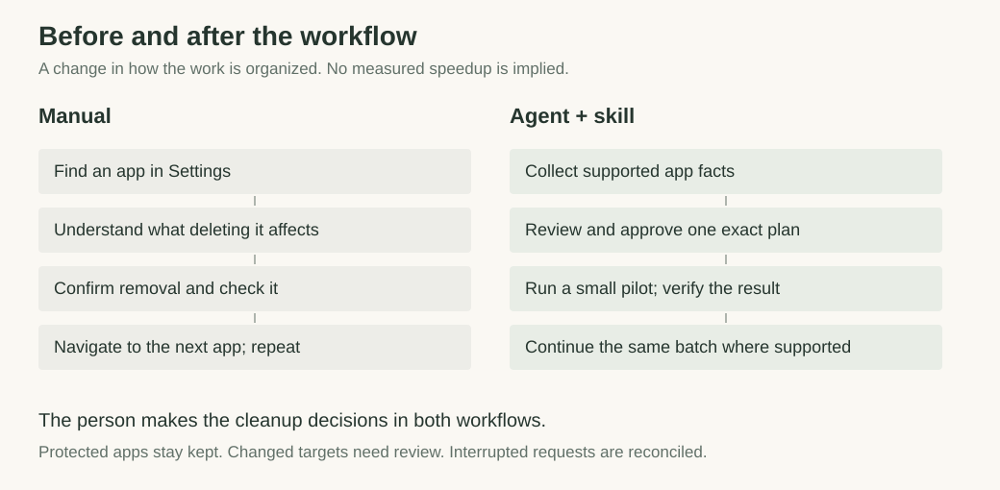
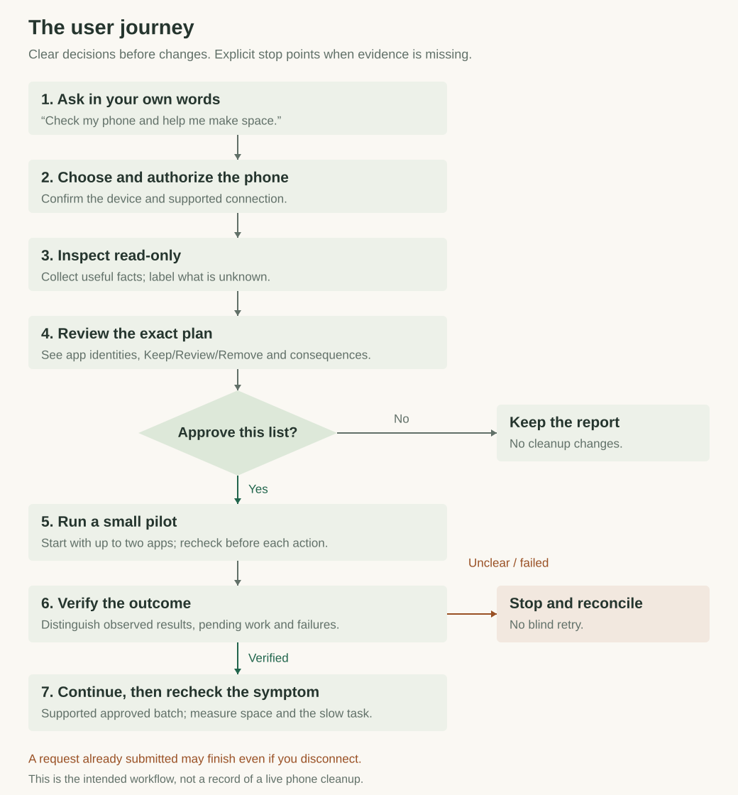
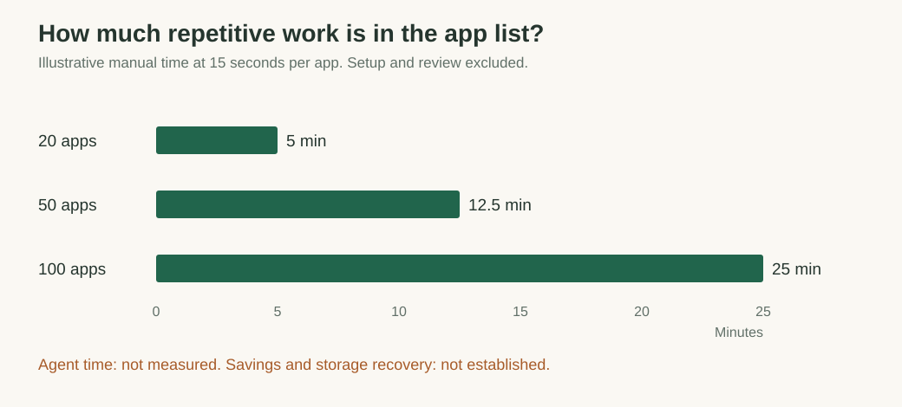

# I asked my AI agent to help with a slow iPhone

*How iPhone Mirroring led to a reusable skill with clearer instructions and guardrails.*

My iPhone was still slow, even after I'd deleted a lot of stuff.

That was what frustrated me. I'd already tried cleaning it up, and I still didn't know what was causing the slowness. So I asked my AI agent to review the phone and help figure out what else might be going on.

The agent couldn't access my iPhone directly from the chat. I opened iPhone Mirroring on my Mac so we had a way to work through the phone's interface.

As we went, I kept adding instructions. Keep the authenticators. Keep the wallets, exchanges and password managers. Check which app you are looking at before removing it. Ask me if you're unsure.

I also wanted the work to move faster. Navigating through screens, looking at apps and checking each action was repetitive. I started wondering how much of this we could turn into a workflow we could use again.

That's where the skill came from. I wanted to give the agent a set of instructions, boundaries and checks it could carry into the next task, without having to rebuild the whole understanding in every conversation.

Agents can still behave unpredictably. A skill does not remove that uncertainty, but it gives us somewhere to make our expectations explicit and add checks around the actions that matter. For me, this was a way to close some of the gap between asking an agent for help and feeling comfortable letting it act.

## iPhone Mirroring gave us a way to work on the phone

The starting point was practical: the phone was in front of me, but the agent did not have a direct way to inspect it.

Mirroring brought the iPhone interface onto the Mac. It gave us a route for on-screen work, provided the assistant could actually read the phone screen and operate its controls reliably.

That condition matters. Seeing a Mirroring window is not the same as being able to inspect the app inside it. If the agent cannot read the screen, scroll or confirm an action, it needs to stop and ask for help. Repeating uncertain taps does not improve the evidence.

There is also a simple interruption rule: the iPhone needs to stay locked for Mirroring. Using it directly stops the mirrored session. An action already submitted may still have completed, so the next step is to check the current state before continuing.

The skill grew beyond that first route. It now includes local scripts for supported iPhone operations over trusted USB, and a separate Android module using an owner-authorized debugging connection. Mirroring remains useful for suitable screen-based work. It does not replace the USB connection required by the iPhone scripts.

## I kept explaining what had to stay

“Help me make space” leaves a lot unsaid.

An app I rarely open can still be important. An authenticator may be essential when I sign in somewhere. A wallet may hold access I cannot recover by downloading the app again. Even an app's name can be misleading: an AI tool and a cryptocurrency exchange can share a name.

I wanted those distinctions resolved before anything was deleted.

The cloud icons raised another issue. Offloading an iPhone app removes its software while preserving documents and data. Deleting the remaining entry removes that saved data too. [Apple explains the difference](https://support.apple.com/en-us/102598). The icon alone cannot tell me whether I am comfortable losing what remains.

And the original symptom still needed attention. A phone can feel slow because of storage, battery wear, heat, connectivity or app behavior. Both [Apple](https://support.apple.com/en-us/102598) and [Google](https://support.google.com/pixelphone/answer/6377329?hl=en) describe causes beyond storage.

That is why the workflow starts with a read-only review. Before proposing more deletions, it should establish what we can observe, what remains unknown and which task actually feels slow.

## I put the recurring instructions into a skill

Phone Health & Cleanup packages that workflow for reuse. The assistant handles the conversation and asks about ambiguous cases. The instructions explain how to proceed, what to protect and when to stop. Local scripts handle supported repeated operations and perform checks on their own execution path.

Instead of navigating every app together, the intended experience is to review one clear list. Each row identifies the app, the proposed action, the reason and the possible data loss. I can correct the list before approving it.

*The intended benefit is fewer repeated navigation steps, while keeping the decision about disposable apps and data with the person.*

The approval applies to that finite list. Newly discovered apps do not quietly join it. Changed targets or consequences need another review. Once an unchanged list is approved, the assistant should not ask the same question again before every tap.

The important instructions also need to survive beyond one conversation. Once the relevant skill is installed and enabled, a person can ask naturally for a phone health check. In a fresh Codex session, a request like this selected the phone workflows and prompted a question about whether the phone was an iPhone or Android:

> My phone is slow. Check its health and help me make some space.

Automatic selection is model-driven, so it can vary. Installation is specific to the host and account; publishing the source on GitHub does not load the skill into every assistant.

## The checks give me something to review

The safety net has several parts. Known sensitive apps stay kept. Unclear identities stay for review. Proposed changes need approval. The workflow starts with a small pilot and checks the result before supported work continues.

*Declining approval keeps the report without changes. An uncertain result stops the batch for reconciliation.*

| Point in the workflow | What it helps prevent |
|---|---|
| Read-only review | Acting on an assumption about what is causing the problem |
| Exact-list approval | Treating a broad request to make space as permission to delete anything |
| Small pilot and verification | Continuing a batch when the actual outcome is unclear |

The Android research found a specific reason to be conservative. Older command handling could interpret an unsupported cache-only request as app-data clearing. The helper therefore requires a supported Android version and the device's advertised cache-only capability. It refuses to retry by dropping that flag. The [research notes](https://github.com/shimoverse/iphone-health-cleanup/blob/main/skills/android-health-cleanup/references/research.md) document the source inspection behind the check.

These protections have limits. The helpers can reject unsafe requests sent through them. An agent with broader command or screen access could bypass the helpers. The instructions do not independently contain everything the host permits, and the plan's fingerprint does not prove that a human approved it.

The skill makes the process more explicit and gives us checks we can inspect. It cannot guarantee that the agent will always behave correctly or that deletion will be reversible.

## I still need to measure what improves

The phone being slow was the reason I started. A cleaner app list or a successful command does not establish that the original problem is fixed.

For an illustration of the repetitive work, assume finding, confirming and checking each app takes 15 seconds. Fifty apps would take 12.5 minutes, before setup and reviewing what to keep.

*These are arithmetic examples. We have not measured the new workflow's end-to-end duration, recovered storage or performance improvement.*

The next comparison needs a timed, owner-approved pilot. I would record active user time, total elapsed time, verified removals and free space, then repeat the task that originally felt slow. First-time setup should be measured separately from recurring use.

Scripts can reduce repeated screenshot conversations. Additional analysts and longer reports also consume tokens. We have not benchmarked token or money savings, and the helpers do not require another paid AI service.

## What trying it looks like

After a read-only review, the assistant should show a list like this. These apps are fictional:

| App | Proposed action | What the person is deciding |
|---|---|---|
| Example Old Game | Uninstall | Whether its local saved progress can be lost |
| Example Trial App | Uninstall | Whether its local content is disposable |
| Example Wallet | Keep | Preserve protected account access |

It should wait for approval of the exact list, run a small pilot and report what was verified. Pending requests and failures need to stay visible. If the connection drops, an operation may already have completed; it should not be blindly repeated.

The companion walkthrough uses fictional apps and connects to no phone. It shows the intended sequence and the approval point, without claiming a completed device cleanup.

## Where it stands today

The [source and setup instructions](https://github.com/shimoverse/iphone-health-cleanup#readme) are public, with separate iPhone and Android modules in one repository. The Android work grew from asking whether the same approach could help on a Google Pixel, while accounting for its different access and permission model.

| Where it is available | Current status |
|---|---|
| GitHub | Original source under MIT; [third-party terms apply](../../NOTICE.md) |
| Local Codex or Claude Code | Install the relevant skill and start a fresh session |
| ChatGPT plugin | A private personal version exists; it is not a public directory release |
| Cowork | Custom plugin packaging is available; installation and phone-tool access need checking |

The helpers have [98 passing offline tests](https://github.com/shimoverse/iphone-health-cleanup/actions/runs/41231530272), including simulated wrong-device selection, protected apps, interrupted requests, false success responses and changed plans. Real-device compatibility and the benefits of the new scripted workflow remain unverified.

For a few apps, Settings may still be easier. Native photo tools are a useful starting point for duplicates and storage suggestions. We do not ship an automatic media-deletion engine. Browser cleanup uses separately scoped native screens or guided steps.

USB read-only checks generally allow ordinary phone use; actual changes need a quiet window. A web chat cannot reach a phone plugged into a Mac just because a skill is installed. Native Windows execution is outside this preview's scope.

I do not expect one skill to make agents fully predictable. I want clearer instructions, visible decisions and a way to check whether the work happened as intended. Using that on an ordinary task, with data I care about, is one way to build confidence in letting agents help with daily life.

## FAQs

### Why not just use Settings or an iPhone cleaner app?

For a few apps, use Settings. Built-in storage recommendations and native photo tools may already solve the problem with less setup.

An ordinary iPhone app is restricted in what it can inspect or change outside its own area. Apple’s [app isolation model](https://support.apple.com/guide/security/security-of-runtime-process-sec15bfe098e/web) means that putting a cleaner interface on the phone does not grant broad control of other apps. This project uses an owner-authorized computer connection for supported operations. Native controls still handle other tasks.

### Why build a skill instead of another mobile application?

The part we wanted to improve was the review-and-execution process: explain the findings, carry the person’s exclusions into a concrete plan, get approval and check the result. A reusable skill fits the assistant the person already uses. Scripts make supported repeated work consistent.

A mobile app could be useful for a narrower job. Android also has package-management APIs with [permission and user-action requirements](https://developer.android.com/reference/android/content/pm/PackageInstaller). Neither approach makes another app’s data universally accessible. We chose a local workflow and accepted its connection/setup cost.

### Is it safe?

The preview includes safeguards and 98 offline tests, but we cannot promise that it will never cause a mistake. Real-device compatibility remains unverified. Approved app deletion can remove useful local data permanently.

Start read-only. Keep anything whose purpose or recovery status you cannot establish. If losing an app’s data would hurt, confirm an appropriate recovery route before approving its removal. The workflow does not create or verify backups automatically.

### What stops the agent from going rogue?

The bundled helpers reject several unsafe requests: a plan that does not match its supplied fingerprint, a mismatched device, protected/unknown candidates and certain changed app states. Execution records help prevent blind repeats within their supported recovery rules.

Those checks cover actions sent through the helpers. A host with broad command-line or screen-control access may let an agent bypass them. Skill instructions are not a security boundary that physically prevents every other action. The plan fingerprint binds a file; it does not independently prove that a human approved it.

This release has no separate approval service that keeps the ability to delete out of the agent’s hands. Human review, the host’s permissions and a narrowly scoped connection still matter.

### How do you avoid deleting something important?

Known sensitive categories are kept: authenticators, exchanges, wallets, password managers, finance/recovery apps and essential services. The Android module also checks system packages and available role, administrator and service protections. Unclear identities stay for review.

The person still confirms which ordinary apps and saved data are disposable. An app may matter even if it has not been opened recently. Name checks and category labels are useful backstops, not a complete map of everyone’s important apps. Exact private exclusions can be added to the plan.

### Which guardrails are code checks, and which depend on the workflow?

| Measure | Where it is enforced | Remaining limit |
|---|---|---|
| Exact-list review and actual human consent | Conversation and host permission process | The helper cannot authenticate who approved the list |
| Plan integrity, device binding and candidate/state checks | Bundled helpers | They cover their own execution path; live state can still change |
| Protected or unresolved app identities | Helper checks plus human classification | Names and classifications cannot recognize every important app |
| Small pilot before wider cleanup | Workflow; Android also restricts scripted continuation | This is not a universal operating-system limit on the host |
| Pending-request handling and local execution records | Helpers within their documented device/plan/journal rules | Records are not tamper-proof and do not coordinate every other tool or computer |
| Preserve Favorites and review browser/media scope | Instructions and native/guided review | No bundled media engine enforces Favorites protection across the whole photo library |

The [iPhone workflow](https://github.com/shimoverse/iphone-health-cleanup/blob/main/skills/iphone-health-cleanup/references/workflow.md) and [Android workflow](https://github.com/shimoverse/iphone-health-cleanup/blob/main/skills/android-health-cleanup/references/workflow.md) document the platform-specific checks. They should not be treated as identical control systems.

### What if it deletes the wrong app? Can I undo it?

There is no universal undo. Downloading an app again does not guarantee that its local data, keys or offline content will return. Sync and backups vary by app, and some data may be unrecoverable.

Stop further changes and preserve the execution records. Establish which action completed, then check the app’s legitimate recovery options. Verification after deletion checks the outcome; it cannot reverse the deletion or prove the original decision was right.

### What if something changes after I approve, or the connection drops?

The helpers recheck relevant device and app state. Changed targets require review. Android uninstall requests also use a supported version guard; iPhone lookup and removal are separate operations, so an idle phone helps reduce a remaining race.

If a request becomes uncertain, stop and reconcile the saved records with the actual phone. Disconnecting or cancelling does not undo a request already submitted. The workflow forbids blind retries; Android also blocks unresolved attempts across changed plans. A new approval alone is not a reason to ignore a pending request.

### Can it remove my photos, passwords or browser history by accident?

The included scripts do not implement photo-library deletion or a universal browser-erasure function. Browser and photo actions use separately scoped native screens or guided steps. Favorites are meant to stay kept; unknown Favorite/cloud status requires review.

Passwords, bookmarks, autofill, downloads and wallet data are outside an ordinary history/cache request. Screen-control tools still carry risk, and sync can spread a deletion beyond one device. Read the actual selection and consequences before proceeding.

### Does my private data leave the phone or computer?

The helpers save minimal reports locally and do not upload them to an AI service. The assistant host may send text or screenshots it reads to its model provider. That provider’s settings and policies still apply.

Keep inventories, connection records and logs outside the public repository. Share minimal summaries. Broad logs, backups, usage histories and photo previews need a separate purpose and permission; they are not routine baseline collection.

### Will it make my phone faster or tell me whether it has been hacked?

It can help investigate and recover storage where supported. A speed improvement needs a comparable before-and-after check of the original slow task. Battery wear, heat, connectivity and app behavior can remain relevant.

Security observations and update recommendations are not a malware-free certificate. This preview provides neither a universal health score nor a forensic assurance that a phone is uncompromised.
