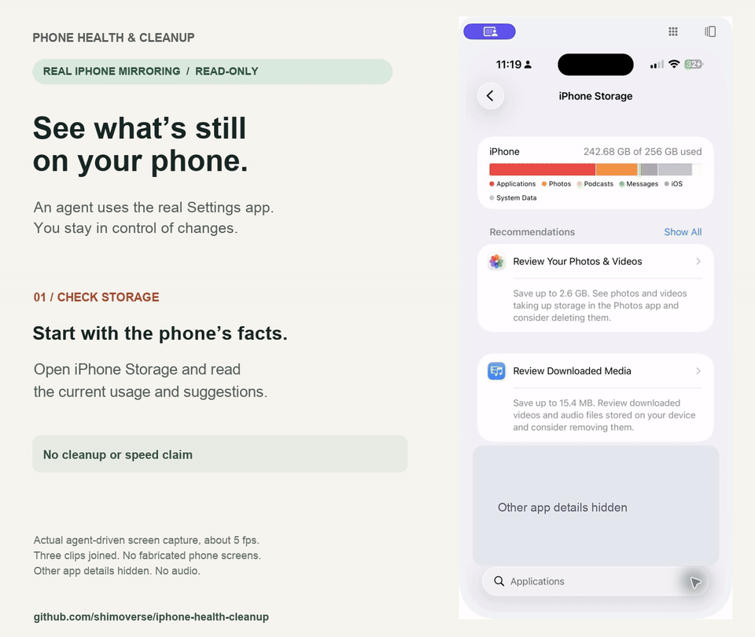

# Real iPhone Mirroring demo

[Watch/download the MP4](iphone-mirroring-live-demo.mp4) · [GIF](iphone-mirroring-live-demo.gif) · [Poster](iphone-mirroring-live-demo-poster.png)

Recorded on November 1, 2026, with the phone owner's permission to create a public GitHub demo. The assistant used the real iPhone Mirroring window through its computer-control tool. The phone screens are captured pixels, not drawn phone UI or an animated simulation.

## What happens

| Part | Observed action or result |
|---|---|
| Storage | Start on the real iPhone Storage overview. |
| Search | The assistant clicks the Applications search field and types Netflix. The cloud icon is visible in the result. |
| Inspect | The assistant opens Netflix's app details. iOS shows Reinstall App and 328.4 MB of Documents & Data. |
| Stop | The assistant returns to the search result. Netflix remains listed. No delete or reinstall request was sent. |

This is one read-only inspection. It does not show a complete app inventory, the user approving a cleanup list, a removal, USB-script verification or measured storage/performance improvement. A real cleanup must first present its exact plan and receive approval. The displayed 328.4 MB is retained app data, not verified recoverable or recovered space.

## Capture and editing

- Duration: 23.67 seconds. MP4: 1280 × 1080, H.264, no audio. GIF: 960 × 810.
- The native Mac recorder did not provide a reliable capture during setup. Instead, the assistant's supported screenshot tool sampled the real Mirroring window continuously during each interaction, at about five frames per second.
- Three captured clips are joined. Gaps between tool calls are omitted; within each clip the edit preserves the captured timing. The output uses six frames per second, repeating captured frames where needed. It is not a continuous high-frame-rate Mac recording or an end-to-end timing benchmark.
- Captions are added beside the captured window. An explicitly labeled opaque mask hides unrelated app rows. No phone controls, data values or successful actions are fabricated.
- Only the reviewed MP4, GIF and poster are published. Raw frames, capture timestamps, local inventories and the recorder test stay outside the repository.
- No messages, photos, browsing history, account identifiers, passwords, authentication codes or financial-app screens appear in the published assets. Every final frame was included in the visual/privacy review; encoded playback and representative frames were also checked.
- The publication guard checks these exact media hashes. Any replacement must receive a fresh privacy review; arbitrary screenshots are still rejected.

Apple and Netflix interfaces and marks belong to their respective owners. Their appearance does not imply endorsement. The project's original captions and documentation are covered by its MIT license; that does not relicense third-party interfaces or marks.

## Earlier concept illustration

The earlier [illustrated GIF](phone-cleanup-demo.gif), [MP4](phone-cleanup-demo.mp4) and [poster](phone-cleanup-demo-poster.png) use fictional apps. They remain historical concept assets and are not the live demo featured in the README. They connect to no phone and prove no cleanup result.

The optional [illustration renderer](../../tools/render_demo.py) creates those concept assets only. It cannot reproduce this live footage and does not operate a phone.
