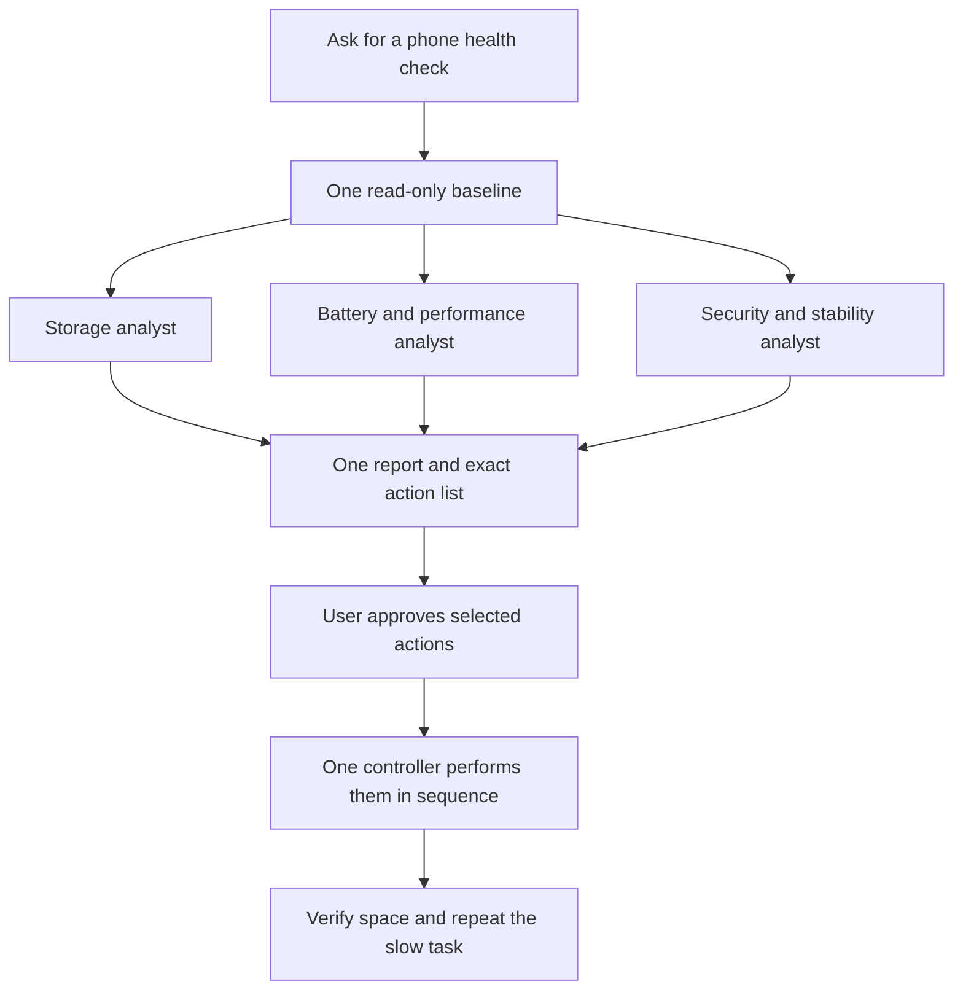

# iPhone health and cleanup: research and implementation decisions

Researched October 31, 2026. Public documentation/source inspection and synthetic tests only; no phone was connected, changed or scanned. This report distinguishes available tooling from a verified end-to-end real-phone workflow.

## Recommendation

Expand the existing skill into an iPhone health and cleanup coordinator. Preserve the narrow app-removal runner; add minimal read-only diagnostics, parallel analysis when useful, one combined action table and one serial controller for approved changes. Do not assemble a universal “optimizer” by installing every candidate project.

The objective is **recover useful storage, explain likely causes of slowness, and complete approved fixes with evidence**. Free storage is measurable; improved responsiveness needs a separate task check. Apple's guidance identifies network, power-saving mode, temperature and battery wear alongside storage pressure, recommends at least 1 GB free, and discourages unnecessary force-closing. [Apple slow-iPhone guidance](https://support.apple.com/en-us/102598).

Workers analyze relevant saved evidence, rather than competing for Settings or running three independent collections. Extra acquisition of logs/backups requires separate, informed opt-in. No model call is needed per app. If the host has no subagents, the same checks work sequentially. Parallel analysis can lower elapsed analysis time, but adds model context and is not automatically cheaper.

## What can be included

| Area | Useful check/action | Execution and evidence boundary |
|---|---|---|
| Storage | Available bytes, installed/offloaded inventory, large-category review, targeted downloads/cache | Bundled USB snapshot and offloaded-app runner; Settings/app UI for other data. Unknown sizes stay unknown. No guaranteed number of recoverable GB from metadata alone. |
| Safari | Remove chosen website data while keeping history, or explicitly clear chosen history timeframe/profile | Supported Settings UI or guided user steps. Cookies/site data can sign users out; history may sync deletion to other devices. No universal USB cache-erasure backend verified. |
| Battery | Apple Maximum Capacity, service/peak-performance message, cycle count where exposed | Settings is the authoritative consumer view. Raw USB fields may be absent or have differing units. Charge level is not battery health. |
| Performance | Establish the slow task and check power, heat, network, recent updates; usage-informed suggestions | Use Battery Settings observations, then targeted evidence if needed. Installed apps alone do not establish actual usage. |
| Stability | Recurring app crashes, watchdogs, Jetsam/panic context | Optional selected local reports. Memory pressure is distinct from disk space; crash evidence alone is not a hardware or malware diagnosis. |
| Security | Installed model/iOS/build versus current advisories; update settings, profiles, permissions and account protections | Observed posture and documented exposure, not exploitation proof or a malware-free certification. User handles secrets and sensitive account screens. |
| Advanced forensics | Selected backup/sysdiagnose analysis against known indicators | Separate opt-in, local storage, versioned sources and coverage; specialist interpretation. Not part of routine cleanup. |

Apple documents separate Safari routes for history/site-data deletion and website-data deletion that preserves history. The full action supports a chosen timeframe; current UI/guide also has profiles. Check actual screen options on the installed iOS. Explain login, offline data and sync consequences before approval. [Safari cleanup](https://support.apple.com/en-us/105082), [iPhone guide](https://support.apple.com/guide/iphone/clear-your-cache-and-cookies-iphacc5f0202/ios), [Apple Safari privacy paper](https://www.apple.com/vn/safari/docs/Safari_White_Paper_Nov_2019.pdf).

For iCloud Drive, prefer **Remove Download** when the intent is local space: it preserves the cloud original. **Delete** has different consequences. Photos and Messages deletion can propagate through iCloud; Recently Deleted/permanent erasure is a separate decision. Cloud sync is not an independent backup. Storage recommendations and optional photo optimization should be evaluated before sweeping personal content. [Files: deletion versus downloads](https://support.apple.com/en-mo/104953), [iPhone storage](https://support.apple.com/en-la/108429), [photo storage](https://support.apple.com/en-us/105061), [iCloud Photos behavior](https://support.apple.com/guide/icloud/what-you-can-do-with-icloud-and-photos-mm8b32f3ae27/icloud), [Messages deletion](https://support.apple.com/en-is/guide/iphone/iph2c9c4bfcb/ios).

## Existing skills and projects worth learning from

Reviewed source/documentation for the listed scope, not a comprehensive audit of every repository. No third-party code bodies or installers were imported. License labels are from the reviewed source; candidates without verified licensing remain inspiration only.

| Source | Reuse | Decision / restriction |
|---|---|---|
| [iphone-app-manager](https://github.com/Nolikzero/claude-skills/tree/9a5dcb481dcb0c448b143bf8ca57054e41a59c6a/skills/iphone-app-manager), MIT | Batch inventory, exact app IDs, review and local reports; awareness of powerlog usage pitfalls | Already selectively adapted. Reject Home Screen rewrites and unsafe unprotected purge. Its old offloaded-lookup limitation is superseded by maintained API support. |
| [pymobiledevice3 Device Operator](https://doronz88.github.io/pymobiledevice3/guides/codex-device-operator-skill/), GPL-3.0+ | Existing CLI/API first, transport prerequisites, explicit mutation scope, machine-readable results | Keep pinned `11.49.0`; separate dependency install. Basic lockdown reads need no default developer setup. Snapshot calls narrow read methods only. |
| [imole](https://github.com/chenhg5/imole/tree/20301aa43a1371bd501c6d96e6e910fae060efbf), MIT | Optional app disk-size ranking, bounded requests, machine-readable schemas and backup manifests | Read selected app/clean source. Do not import remote installer or broad photo-delete semantics. Fresh backup validation and exact-device checks remain necessary. |
| [iphone-image-manager safety model](https://github.com/andrewbakercloudscale/iphone-image-manager/blob/ad20b76b1f0f01a91c05ed8bd8830aa65102f2d1/docs/SAFETY.md), MIT | Original/Live Photo/sidecar grouping, cloud-proxy checks, fresh backup verification | Raw AFC deletion can leave broken Photos references; its tested device refused ImageCaptureCore deletion. No automatic photo backend adopted. |
| [PhotoSwipe](https://github.com/noluyorAbi/photoswipe-ios/tree/d542440a6ecd1fbacce0ad335e84cac61fe1e2d1), MIT | Local review queues and native PhotoKit confirmation | Standalone iOS app, not a USB skill. Avoid its undocumented KVC size estimate as a guaranteed-space calculation. |
| [iphone-use skill](https://github.com/leeguooooo/iphone-use/blob/b05fe76449c03e594e06aa182b9e2e403fc71223/skills/iphone-use/SKILL.md), PolyForm Shield 1.0.0 | Text-based screen reads, one phone owner, reusable flows, explicit uncertain outcomes | Source-available/noncompete license, not permissive open source. Optional separately audited UI adapter; no installation/code copying. Signing/Developer Mode/setup are extra. No upstream latency claim treated as our benchmark. |
| [Mobile MCP](https://github.com/mobile-next/mobile-mcp), [roadmap](https://github.com/mobile-next/mobile-mcp/blob/main/ROADMAP.md), MIT stated | Another structured UI adapter to evaluate if needed | Current physical-iOS Device Kit documentation supersedes its old WDA/go-ios wiki. Direct clear-app-storage covers Android/simulator, not physical iPhone. Default telemetry needs review; not installed. |
| [iLEAPP](https://github.com/abrignoni/iLEAPP), MIT | Local modular parsing of authorized artifacts with timestamps/source context | Advanced optional parser; full forensic extraction is too broad for routine health. No default installation. |
| [iPhone-sysdiagnose-parser](https://github.com/ThatLastGamer/iPhone-sysdiagnose-parser), MIT stated | Missing-aware, timestamped facts from selected battery logs | Small source reference only; community capacity ratios/hardware attribution not validated across models. |
| [iOS Analytics File Parser](https://github.com/Panaikran/ios-analytics-file-parser) | Sanitized local parsing, supported-format boundaries, cautious explanations | Documentation/pattern inspiration only, license not verified; no source copied. |
| [iphone-malware-assessment](https://github.com/lordx64/iphone-malware-assessment/tree/14c676934499288952469158937c5e9708466fd6), MIT-0 | Separate indicator matches, heuristics and acquisition coverage | Reject unchanged installation: empty-directory synthetic test incorrectly reports CLEAN; pipeline also changes setup/encryption and weakly checks backup success. |
| [MVT v2026.10.26](https://github.com/mvt-project/mvt/releases/tag/v2026.10.26), MVT License 1.1 | Expert known-indicator analysis with explicit consent and documented coverage | Optional forensic path; license includes consensual-use restriction. No match cannot establish a clean phone. Not installed. |

The small Nolikzero usage reference describes powerlog aggregation. Preserve its warning against summing hourly and daily rollups together. An active-hour proxy is not launch count or average session length, and absent entries are not proof of non-use. Do not automatically acquire a large sysdiagnose to decide whether to delete an offloaded app. [Usage reference](https://github.com/Nolikzero/claude-skills/blob/9a5dcb481dcb0c448b143bf8ca57054e41a59c6a/skills/iphone-app-manager/references/usage-stats.md).

## Battery, logs and security: evidence limits

Apple exposes health, performance and model-dependent cycle information in Settings. Battery wear and peak power are relevant to slowness, but no arbitrary cycle count or USB capacity ratio is a universal replacement diagnosis. Recent setup/updates may cause temporary background activity. Use a service message and symptoms rather than guessing. [Battery and performance](https://support.apple.com/en-us/106348), [battery drain guidance](https://support.apple.com/en-ie/120745), [Battery usage](https://support.apple.com/en-ie/102432).

The pinned diagnostics implementation returns `IOPMPowerSource` data with no standardized field/unit normalization. It may return no battery data. MobileGestalt is not a reliable required path on iOS17.4+. The crash service's `get_new_sysdiagnose()` defaults to erasing the pulled archive: an optional capture must explicitly use `erase=False`. Never flush/clear logs in the default check. DVT CPU/RAM sampling is an advanced developer path, not long-term usage history. [Pinned diagnostics source](https://github.com/doronz88/pymobiledevice3/blob/d98fb4154855738101f39fb104bad988983aa373/pymobiledevice3/services/diagnostics.py), [pinned crash source](https://github.com/doronz88/pymobiledevice3/blob/d98fb4154855738101f39fb104bad988983aa373/pymobiledevice3/services/crash_reports.py), [Apple crash/log interpretation](https://developer.apple.com/documentation/xcode/diagnosing-issues-using-crash-reports-and-device-logs).

Security checks should consult the live [Apple security release index](https://support.apple.com/en-us/100100) for the exact model and supported branch, then distinguish update exposure from exploitation. Review [profiles](https://support.apple.com/guide/iphone/install-or-remove-configuration-profiles-iph6c493b19/ios), [Safety Check](https://support.apple.com/en-ca/guide/personal-safety/ips2aad835e1/web) and [App Privacy Report](https://support.apple.com/en-ca/102188) only within the requested privacy scope. Work profiles/VPNs can be legitimate. Privacy reports start after enablement; missing history is unknown. [Lockdown Mode](https://support.apple.com/en-gb/105120) is a targeted protection decision, not a standard optimization. App sandboxing and limited host services prevent promising arbitrary whole-device file inspection or cache deletion. [Apple runtime security](https://support.apple.com/en-gb/guide/security/sec15bfe098e/web).

MVT explicitly frames itself as investigator tooling and warns public indicators cannot certify absence of compromise. Its sysdiagnose workflow needs forensic plugins; zero loaded plugins must yield not assessed. [Introduction](https://docs.mvt.re/en/latest/introduction/), [sysdiagnose analysis](https://docs.mvt.re/en/latest/ios/sysdiagnose/). Encrypted backups may include passwords, website history, Health and other private records, so collection and AI processing are separate consent decisions. Never place backup passwords in commands/prompts, auto-reset forgotten backup settings, or upload raw archives. [MVT backup acquisition](https://docs.mvt.re/en/latest/ios/backup/pymobiledevice3/), [Apple encrypted backups](https://support.apple.com/en-lb/108353).

If credible targeted compromise or an [Apple threat notification](https://support.apple.com/en-us/102174) is involved, pause routine history/cache deletion and preserve evidence while choosing specialist help. Ordinary phone slowness is not evidence of spyware.

## Delivered now versus later validation

| Status | Capability |
|---|---|
| Implemented; offline tested | Existing protected, exact-list app runner; minimal read-only health snapshot; offline partial scorecard; multi-agent task contracts and approval/verification workflow |
| Documented coordinator workflow | Safari options, app-native cache/download review, Files local-copy removal, selected media/messages review, Battery/Settings/security posture checks via supported UI or user assistance |
| Optional; not installed/integrated | New UI-control adapter, broad usage-log parsing, backup/media-deletion pipeline, MVT/iLEAPP investigation |
| Unverified until a real run | Current-device USB field support, exact UI readiness, actual recovered space, battery findings and improved responsiveness |

Use a category scorecard with evidence coverage instead of a fake universal number. Each proposed action names exact targets, consequence, method, expected benefit and success check. One approval can cover selected rows, and the coordinator executes the unchanged approved scope without another prompt for every tap. No blanket ongoing deletion. Recheck state and verify completed actions, then measure free space and repeat the actual slow task separately.

For latency/cost: local scripts do repetitive work; narrow agents analyze minimized summaries; detailed logs are read only when needed. No extra Jev connection is required. An optional cheaper UI model may change UI cost, but doesn't fix missing access, approval or verification. Published third-party speed claims were not benchmarked here. Initial planning targets are 2–5 minutes for a ready-connection baseline/report and 5–15 for guided settings review; data transfers/forensics may take much longer. Replace those estimates with measured timings from the first real-device session.
